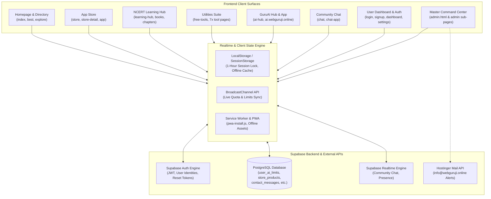
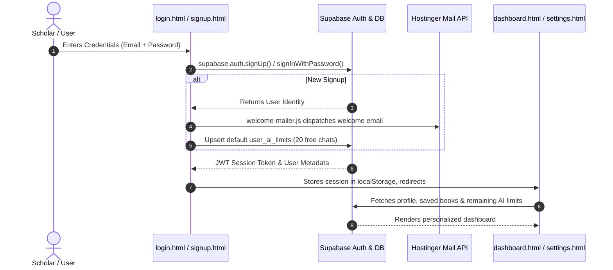
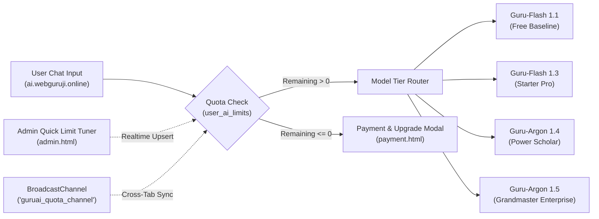
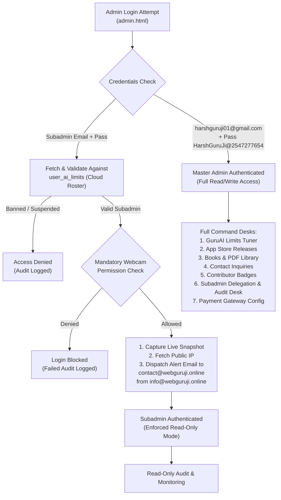

# HarshGuruJi (`webguruji.online`) — Complete Website Architecture & Page Workflow Masterplan

> **Platform Brand**: **HarshGuruJi**  
> **Production Domain**: `webguruji.online` (Subdomains: `ai.webguruji.online`, `chat.webguruji.online`, `store.webguruji.online`, `books.webguruji.online`)  
> **Founder / Master Admin**: Harsh Patel (`harshguruji01@gmail.com`)  
> **Tech Architecture**: High-speed Client-First Static Single-Page & Multi-Page Hybrid (ES6 Modules, Supabase Backend, Hostinger Mail API, LocalStorage/BroadcastChannel State Sync).

---

## 1. High-Level System Architecture & Ecosystem Flow

HarshGuruJi is structured as a decoupled, multi-subsystem educational and utility super-platform. Every page functions client-side with zero server lag, communicating with Supabase for persistent state and real-time synchronization.

---

## 2. Complete Page-by-Page Workflow & Functional Blueprint

The platform contains **51 core HTML routes** in `site` plus **12 specialized routes** in `ai`. Below is the exhaustive workflow breakdown organized by functional sector.

---

### Category A: Core Discovery & Public Landing Pages

#### 1. [index.html](file:///c:/Users/harsh/OneDrive/Desktop/HarshGuruJi/site/index.html) — Main Gateway & Platform Portal
- **Purpose**: Central hub connecting users to every HarshGuruJi vertical.
- **Workflow & Interactivity**:
  1. **Hero & Dynamic Ticker**: Shows live statistics (active tools, registered scholars, free downloads) and real-time site announcements.
  2. **Quick Launch Bento Grid**: 1-click launchpads to GuruAI, NCERT Books, App Store, Free Tools, and Games.
  3. **PWA & Offline Installation**: `pwa-install.js` triggers an automated install banner for mobile and desktop home screen pinning.
  4. **Ad & Cookie Shield**: `cookie.html` modal manages user consent; `error-shield.js` intercepts uncaught script errors to guarantee 99.9% uptime.
  5. **Global Search Bar**: Instant live filtering overlay across apps, books, and utilities.

#### 2. [best.html](file:///c:/Users/harsh/OneDrive/Desktop/HarshGuruJi/site/best.html) / [best/index.html](file:///c:/Users/harsh/OneDrive/Desktop/HarshGuruJi/site/best/index.html) — Curated Highlights
- **Purpose**: Showcase the highest-rated tools, most downloaded APKs, and top NCERT textbooks.
- **Workflow**: Ranks content dynamically based on community ratings and popularity metrics stored in local storage and product schemas.

#### 3. [explore.html](file:///c:/Users/harsh/OneDrive/Desktop/HarshGuruJi/site/explore.html) — Interactive Directory Search
- **Purpose**: Searchable catalog of the entire HarshGuruJi repository.
- **Workflow**: Driven by [explore.js](file:///c:/Users/harsh/OneDrive/Desktop/HarshGuruJi/site/js/explore.js); provides instant client-side tag filtering (`All`, `Apps`, `Learning`, `Tools`, `AI`, `Games`) with debounce-free search.

#### 4. [daily-special.html](file:///c:/Users/harsh/OneDrive/Desktop/HarshGuruJi/site/daily-special.html) & [daily-life.html](file:///c:/Users/harsh/OneDrive/Desktop/HarshGuruJi/site/daily-life.html) — Daily Highlights & Lifestyle Guides
- **Purpose**: Habit trackers, daily student motivation, tips of the day, and productivity hacks.
- **Workflow**: Generates algorithmic daily rotations (based on current calendar day) of quotes, formulas, study timers, and workflow checklists.

#### 5. [insights.html](file:///c:/Users/harsh/OneDrive/Desktop/HarshGuruJi/site/insights.html) — Technology Insights & Articles
- **Purpose**: Deep-dive tutorials on web development, artificial intelligence, cybersecurity, and board exam tips.
- **Workflow**: Clean reader layout with reading progress indicator, code snippets, and social sharing.

#### 6. [about.html](file:///c:/Users/harsh/OneDrive/Desktop/HarshGuruJi/site/about.html) & [owner.html](file:///c:/Users/harsh/OneDrive/Desktop/HarshGuruJi/site/owner.html) — About Platform & Founder Profile
- **Purpose**: Institutional credibility, mission statement, tech stack disclosures, and profile of founder Harsh Patel.
- **Workflow**: Direct social verification links, milestone timeline, and contact CTA linking directly to `/contact.html`.

#### 7. [contact.html](file:///c:/Users/harsh/OneDrive/Desktop/HarshGuruJi/site/contact.html) — Support & Direct Inquiries
- **Purpose**: Bi-directional communication channel between users and HarshGuruJi administration.
- **Workflow**:
  1. User fills Name, Email, Subject, and Inquiry message.
  2. Submits payload to Supabase table `contact_messages`.
  3. Displays a unique Tracking Reference ID to the user.
  4. Generates live notification inside Master Admin panel ([admin.html](file:///c:/Users/harsh/OneDrive/Desktop/HarshGuruJi/site/admin.html)).
  5. When Master Admin replies, user can check status and read the reply live on this page.

---

### Category B: User Authentication & Personal Command Center

#### 8. [signup.html](file:///c:/Users/harsh/OneDrive/Desktop/HarshGuruJi/site/signup.html) & [login.html](file:///c:/Users/harsh/OneDrive/Desktop/HarshGuruJi/site/login.html)
- **Workflow**:
  - Handles client-side validation, password strength indicators, and Supabase Auth session handshake (`auth.js`).
  - Upon signup, [welcome-mailer.js](file:///c:/Users/harsh/OneDrive/Desktop/HarshGuruJi/site/js/welcome-mailer.js) triggers an automated welcome message via Hostinger Mail.
  - Automatically provisions a baseline quota record in `user_ai_limits` (20 daily chats on `Guru-Flash 1.1`).

#### 9. [forgot-password.html](file:///c:/Users/harsh/OneDrive/Desktop/HarshGuruJi/site/forgot-password.html) & [reset-password.html](file:///c:/Users/harsh/OneDrive/Desktop/HarshGuruJi/site/reset-password.html)
- **Workflow**: Sends password recovery email via Supabase Auth; extracts hash tokens on return and securely updates password credentials.

#### 10. [dashboard.html](file:///c:/Users/harsh/OneDrive/Desktop/HarshGuruJi/site/dashboard.html) — User Command Dashboard
- **Workflow**:
  - Reads active auth state from `localStorage` via [dashboard.js](file:///c:/Users/harsh/OneDrive/Desktop/HarshGuruJi/site/js/dashboard.js).
  - Displays user profile, assigned role, activity score, saved NCERT bookmarks, game high scores, and remaining GuruAI chat quota.

#### 11. [settings.html](file:///c:/Users/harsh/OneDrive/Desktop/HarshGuruJi/site/settings.html) & [appearance.html](file:///c:/Users/harsh/OneDrive/Desktop/HarshGuruJi/site/appearance.html)
- **Workflow**:
  - Allows updating display name, avatar choice, dark/light/neon cyber theme selection, and device session termination.

---

### Category C: HarshGuruJi App Store & Release Ecosystem

#### 12. [store.html](file:///c:/Users/harsh/OneDrive/Desktop/HarshGuruJi/site/store.html) — Official App Store
- **Purpose**: Software repository hosting custom-built HarshGuruJi applications:
  - **HarshGuruJi Chess**: Realtime & AI chess engine with interactive board.
  - **HarshGuruJi ChatBase**: Local offline-first encrypted messaging & knowledge client.
  - **HarshGuruJi GuruTube**: Ad-free educational streaming application.
  - **HarshGuruJi System Service**: Device diagnostic and telemetry utility.
- **Workflow**:
  - Driven by [store.js](file:///c:/Users/harsh/OneDrive/Desktop/HarshGuruJi/site/js/store.js).
  - Queries Supabase table `store_products` for live versions, release notes, and download mirrors.
  - Platform filter buttons (Android APK, Windows PC EXE, Web App).

#### 13. [store-detail.html](file:///c:/Users/harsh/OneDrive/Desktop/HarshGuruJi/site/store-detail.html) & [app.html](file:///c:/Users/harsh/OneDrive/Desktop/HarshGuruJi/site/app.html) — App Release & Download Landing
- **Workflow**:
  - Reads `?app=<id>` query parameter.
  - Renders release changelogs, system compatibility matrices, and verified download buttons.
  - Increments download counter in Supabase `downloads` table on click.

---

### Category D: NCERT Learning Hub & Digital Bookshelf

#### 14. [learning-hub.html](file:///c:/Users/harsh/OneDrive/Desktop/HarshGuruJi/site/learning-hub.html) & [learning.html](file:///c:/Users/harsh/OneDrive/Desktop/HarshGuruJi/site/learning.html) — Educational Gateway
- **Workflow**:
  - Main portal for students covering CBSE/NCERT Classes 9, 10, 11, and 12.
  - Subject cards (Science, Maths, Social Studies, English, Hindi, Computer Science).
  - Stores student progress via [learning-progress.js](file:///c:/Users/harsh/OneDrive/Desktop/HarshGuruJi/site/js/learning-progress.js).

#### 15. [learning/class.html](file:///c:/Users/harsh/OneDrive/Desktop/HarshGuruJi/site/learning/class.html), [learning/subject.html](file:///c:/Users/harsh/OneDrive/Desktop/HarshGuruJi/site/learning/subject.html), [learning/chapter.html](file:///c:/Users/harsh/OneDrive/Desktop/HarshGuruJi/site/learning/chapter.html)
- **Workflow**:
  - Dynamic hierarchical curriculum reader powered by [ncert-master-catalog.js](file:///c:/Users/harsh/OneDrive/Desktop/HarshGuruJi/site/js/ncert-master-catalog.js) (967KB rich educational dataset).
  - Pulls chapter explanations, key definitions, sample question solutions, and quick revision cards.

#### 16. [learning/class-10-science.html](file:///c:/Users/harsh/OneDrive/Desktop/HarshGuruJi/site/learning/class-10-science.html) & Dedicated NCERT Chapters
- **Workflow**: Complete textbook modules (e.g. *Chemical Reactions and Equations*, *Acids Bases and Salts*) with interactive formula calculators and self-assessment quizzes.

#### 17. [books.html](file:///c:/Users/harsh/OneDrive/Desktop/HarshGuruJi/site/books.html) & [learning/pdf-library.html](file:///c:/Users/harsh/OneDrive/Desktop/HarshGuruJi/site/learning/pdf-library.html) — PDF Library
- **Workflow**:
  - Embedded PDF reader engine ([books-engine.js](file:///c:/Users/harsh/OneDrive/Desktop/HarshGuruJi/site/js/books-engine.js)) supporting zoom, dark-mode inverted PDF viewing, and chapter-wise download links.

#### 18. [learning/gk-quiz.html](file:///c:/Users/harsh/OneDrive/Desktop/HarshGuruJi/site/learning/gk-quiz.html) & [Quiz India/index.html](file:///c:/Users/harsh/OneDrive/Desktop/HarshGuruJi/site/Quiz%20India/index.html) — National & GK Quizzes
- **Workflow**:
  - Timed 10-question competitive quizzes with score evaluation, instant correct answer reveals, and performance percentile graphs ([quiz-engine.js](file:///c:/Users/harsh/OneDrive/Desktop/HarshGuruJi/site/js/quiz-engine.js)).

---

### Category E: GuruAI Subsystem & Subdomain (`ai.webguruji.online`)

#### 19. [ai-hub.html](file:///c:/Users/harsh/OneDrive/Desktop/HarshGuruJi/site/ai-hub.html) & [ai.html](file:///c:/Users/harsh/OneDrive/Desktop/HarshGuruJi/site/ai.html) — Web Portal
- **Workflow**: Showcases GuruAI capabilities (code generation, doubt resolution, paper analysis) and provides launch links to `ai.webguruji.online`.

#### 20. `ai.webguruji.online` (`ai/index.html` & `ai/dashboard.html`)
- **Workflow**:
  - Full AI assistant interface with streaming responses, code formatting, KaTeX mathematical notation, and session chat export.
  - **Model Tiering**:
    - `Guru-Flash 1.1` (Default free tier, 20 chats/day)
    - `Guru-Flash 1.3` (Starter Pro, 32k context)
    - `Guru-Argon 1.4` (Power Scholar, 64k context)
    - `Guru-Argon 1.5` (Grandmaster Enterprise, 128k context)
  - **Realtime Quota Sync**:
    - Reads quota directly from Supabase `user_ai_limits`.
    - Automatically updates remaining chat count when Master Admin tunes limits via `BroadcastChannel` and Supabase realtime postgres_changes.

#### 21. [payment.html](file:///c:/Users/harsh/OneDrive/Desktop/HarshGuruJi/site/payment.html) & [payment/index.html](file:///c:/Users/harsh/OneDrive/Desktop/HarshGuruJi/site/payment/index.html)
- **Workflow**:
  - Handles plan upgrade requests via direct UPI QR code.
  - Submits transaction reference (UTR) to Supabase `contact_messages`.
  - Master Admin verifies in [admin.html](file:///c:/Users/harsh/OneDrive/Desktop/HarshGuruJi/site/admin.html) with 1-click unlock, automatically upgrading user's `user_ai_limits` and triggering an activation email from `info@webguruji.online`.

---

### Category F: Free Utilities & Interactive Tools

#### 22. [tools.html](file:///c:/Users/harsh/OneDrive/Desktop/HarshGuruJi/site/tools.html) & [free-tools.html](file:///c:/Users/harsh/OneDrive/Desktop/HarshGuruJi/site/free-tools.html)
- **Purpose**: All-in-one suite of 7 client-side developer and daily utilities ([tool-hub.js](file:///c:/Users/harsh/OneDrive/Desktop/HarshGuruJi/site/js/tool-hub.js), [tools.js](file:///c:/Users/harsh/OneDrive/Desktop/HarshGuruJi/site/js/tools.js)).

| Tool Page | Primary Functionality | Privacy Guarantee |
| :--- | :--- | :--- |
| [tools/password-generator.html](file:///c:/Users/harsh/OneDrive/Desktop/HarshGuruJi/site/tools/password-generator.html) | High-entropy crypto password generator with custom rules | 100% Client-Side (`crypto.getRandomValues`) |
| [tools/word-counter.html](file:///c:/Users/harsh/OneDrive/Desktop/HarshGuruJi/site/tools/word-counter.html) | Live word, character, reading time, and keyword density checker | In-browser processing |
| [tools/json-formatter.html](file:///c:/Users/harsh/OneDrive/Desktop/HarshGuruJi/site/tools/json-formatter.html) | JSON validator, formatter, minifier, and error highlighter | Zero network transmission |
| [tools/case-converter.html](file:///c:/Users/harsh/OneDrive/Desktop/HarshGuruJi/site/tools/case-converter.html) | Case conversion (camelCase, snake_case, PascalCase, UPPER) | Instant memory transform |
| [tools/base64.html](file:///c:/Users/harsh/OneDrive/Desktop/HarshGuruJi/site/tools/base64.html) | Text and file Base64 encoder/decoder | Local blob reader |
| [tools/bmi-calculator.html](file:///c:/Users/harsh/OneDrive/Desktop/HarshGuruJi/site/tools/bmi-calculator.html) | Metric & imperial BMI calculation with dietary advice | No data stored |
| [tools/percentage-calculator.html](file:///c:/Users/harsh/OneDrive/Desktop/HarshGuruJi/site/tools/percentage-calculator.html) | Multi-mode percentage calculations (increase, decrease, delta) | Instant math calculation |

---

### Category G: Gaming Hall & Community Realtime Chat

#### 23. [gaming-hub.html](file:///c:/Users/harsh/OneDrive/Desktop/HarshGuruJi/site/gaming-hub.html) & [gaming.html](file:///c:/Users/harsh/OneDrive/Desktop/HarshGuruJi/site/gaming.html)
- **Workflow**:
  - Arcade dashboard ([gaming-hub.js](file:///c:/Users/harsh/OneDrive/Desktop/HarshGuruJi/site/js/gaming-hub.js), [gaming.js](file:///c:/Users/harsh/OneDrive/Desktop/HarshGuruJi/site/js/gaming.js)).
  - Host 3 native web games:
    - [games/snake.html](file:///c:/Users/harsh/OneDrive/Desktop/HarshGuruJi/site/games/snake.html): Retro canvas snake with food multipliers.
    - [games/tic-tac-toe.html](file:///c:/Users/harsh/OneDrive/Desktop/HarshGuruJi/site/games/tic-tac-toe.html): Unbeatable Minimax AI bot & 2-player mode.
    - [games/memory.html](file:///c:/Users/harsh/OneDrive/Desktop/HarshGuruJi/site/games/memory.html): Visual card matching game testing memory speed.
  - Scores persist in local storage and can sync to community leaderboards.

#### 24. [chat.html](file:///c:/Users/harsh/OneDrive/Desktop/HarshGuruJi/site/chat.html) & [chat-app.html](file:///c:/Users/harsh/OneDrive/Desktop/HarshGuruJi/site/chat-app.html)
- **Workflow**:
  - Live community discussion rooms powered by Supabase Realtime Channels ([chat.js](file:///c:/Users/harsh/OneDrive/Desktop/HarshGuruJi/site/js/chat.js)).
  - Topic channels (General, Coding, NCERT Doubts, App Feedback).
  - Nickname persistence, typing indicators, and anti-spam message rate limiting.

---

### Category H: Contributor Network & Golden Tick Verification

#### 25. [contributor.html](file:///c:/Users/harsh/OneDrive/Desktop/HarshGuruJi/site/contributor.html)
- **Purpose**: Program overview detailing author, developer, and student contributor tiers (Bronze, Silver, Gold).

#### 26. [apply-contributor.html](file:///c:/Users/harsh/OneDrive/Desktop/HarshGuruJi/site/apply-contributor.html) & [join-contributor.html](file:///c:/Users/harsh/OneDrive/Desktop/HarshGuruJi/site/join-contributor.html)
- **Workflow**:
  - Contributor application form capturing applicant details, portfolio URL, and domain expertise.
  - Submits application directly into Supabase table `contributor_applications`.

#### 27. [verify-contributor.html](file:///c:/Users/harsh/OneDrive/Desktop/HarshGuruJi/site/verify-contributor.html) — Golden Tick Lookup
- **Workflow**:
  - Public verification tool allowing third parties to check a contributor's Golden Tick status.
  - Queries `contributors` table by Contributor ID or Email and displays verified credentials, active badges, and contribution records.

---

### Category I: Master Command Center & Security Operations

#### 28. [admin.html](file:///c:/Users/harsh/OneDrive/Desktop/HarshGuruJi/site/admin.html) — Master Command Center
- **Core Security Modules**:
  1. **Gate Pass Security Gate**: Master Admin (`harshguruji01@gmail.com` / `HarshGuruJi@2547277654`) & Subadmin authentication.
  2. **Mandatory Subadmin Camera Enforcement**: Subadmins MUST grant webcam permission; live snapshot is captured, device IP recorded, and a security alert is dispatched immediately via Hostinger Mail API to `contact@webguruji.online`.
  3. **Cloud Subadmin Synchronization**: Subadmin credentials automatically sync to Supabase under `admin_subadmins_roster@webguruji.online`, allowing multi-device/multi-laptop access.
  4. **1-Hour Auto Session Expiry**: Enforces session timeout for security.
- **Operational Command Desks**:
  1. **GuruAI Live Operations Desk**: Realtime user roster, model switcher, and Quick Limit Tuner (`handleQuickAiLimitSave`).
  2. **App Releases Desk**: APK/EXE metadata publishing, version bumps, download mirror management.
  3. **Books & NCERT Library Desk**: Add and modify textbook links, chapter notes, and PDF assets.
  4. **Support & Inquiries Desk**: View and reply to messages from `/contact.html`.
  5. **Contributor Approvals Desk**: Review applications and grant Golden Tick verification badges.
  6. **Payment Gateway Settings**: Manage UPI QR codes, active gateway maintenance toggles, and manual activation.
  7. **Subadmin Delegation & Login Audit Desk**: View all admin/subadmin logins with webcam snapshots, timestamps, IP addresses, and 1-click ban/suspend controls.
- **Specialized Admin Sub-pages**:
  - [admin-chatbase.html](file:///c:/Users/harsh/OneDrive/Desktop/HarshGuruJi/site/admin-chatbase.html): ChatBase message database management.
  - [admin-contacts.html](file:///c:/Users/harsh/OneDrive/Desktop/HarshGuruJi/site/admin-contacts.html): Contact message filter and reply desk.
  - [admin-requests.html](file:///c:/Users/harsh/OneDrive/Desktop/HarshGuruJi/site/admin-requests.html): Feature and book requests backlog.
  - [adminapkupload.html](file:///c:/Users/harsh/OneDrive/Desktop/HarshGuruJi/site/adminapkupload.html): Binary file and APK upload interface.
  - [adminbooks.html](file:///c:/Users/harsh/OneDrive/Desktop/HarshGuruJi/site/adminbooks.html): NCERT books catalog manager.
  - [admincontributors.html](file:///c:/Users/harsh/OneDrive/Desktop/HarshGuruJi/site/admincontributors.html): Contributor badge management.

---

### Category J: Legal Disclaimers & Regulatory Policies

#### 29. [privacy-policy.html](file:///c:/Users/harsh/OneDrive/Desktop/HarshGuruJi/site/privacy-policy.html), [terms-and-conditions.html](file:///c:/Users/harsh/OneDrive/Desktop/HarshGuruJi/site/terms-and-conditions.html), [cookie.html](file:///c:/Users/harsh/OneDrive/Desktop/HarshGuruJi/site/cookie.html), [disclaimer.html](file:///c:/Users/harsh/OneDrive/Desktop/HarshGuruJi/site/disclaimer.html)
- **Workflow**:
  - Full legal disclosures covering educational fair-use under Indian copyright laws, third-party software distribution liabilities, user data protection, and cookie preferences.

---

## 3. Database Schema Blueprint (Supabase Mapping)

Every page maps to a structured table in Supabase (`wumdbpyhpblvgjttsbpv.supabase.co`):

| Database Table | Primary Columns | Associated Pages & Workflows |
| :--- | :--- | :--- |
| `user_ai_limits` | `id`, `user_id`, `email`, `max_requests`, `context_limit`, `plan_name`, `is_active`, `updated_at` | `admin.html` (Quick Tuner), `ai.webguruji.online` (Live Quota), `signup.html` (Default Quota) |
| `contact_messages` | `id`, `name`, `email`, `subject`, `message`, `admin_reply`, `status`, `created_at` | `contact.html` (Submit/View), `admin.html` (Reply/Manage), `payment.html` (UTR Verification) |
| `store_products` | `id`, `name`, `category`, `version`, `download_url`, `icon_url`, `description` | `store.html` (Catalog), `store-detail.html` (App Specs), `adminapkupload.html` (Release Update) |
| `contributor_applications` | `id`, `full_name`, `email`, `role`, `portfolio_url`, `status`, `created_at` | `apply-contributor.html` (Submit), `admincontributors.html` (Review/Approve) |
| `contributors` | `id`, `email`, `badge_type`, `verified_since`, `contributions_count` | `verify-contributor.html` (Golden Tick Lookup), `contributor.html` (Showcase) |
| `ncert_books` | `id`, `class_num`, `subject`, `chapter_num`, `title`, `pdf_url` | `books.html` (Digital Library), `learning/pdf-library.html`, `adminbooks.html` |
| `game_scores` | `id`, `game_name`, `player_name`, `score`, `created_at` | `games/snake.html`, `games/memory.html`, `dashboard.html` (High Scores) |

---

## 4. Summary of Key Platform Workflows

1. **User Onboarding Workflow**:
   - `index.html` $\rightarrow$ `signup.html` $\rightarrow$ Welcome email dispatched via `info@webguruji.online` $\rightarrow$ Base quota provisioned $\rightarrow$ `dashboard.html` $\rightarrow$ Full access to tools, books, and AI.
2. **GuruAI Quota & Upgrade Workflow**:
   - `ai.webguruji.online` $\rightarrow$ Quota exhausted $\rightarrow$ `payment.html` (UPI QR Code) $\rightarrow$ UTR submitted to `contact_messages` $\rightarrow$ Master Admin verifies in `admin.html` $\rightarrow$ Live quota upgraded via `user_ai_limits` $\rightarrow$ `BroadcastChannel` immediately unlocks AI on user's browser.
3. **Admin Security & Subadmin Workflow**:
   - `admin.html` Gate Pass $\rightarrow$ Subadmin credentials verified $\rightarrow$ Live webcam permission requested $\rightarrow$ If denied: Login terminated $\rightarrow$ If approved: Snapshot taken, IP recorded, alert email dispatched to `contact@webguruji.online`, and session unlocked in read-only mode.
4. **NCERT Study Workflow**:
   - `learning-hub.html` $\rightarrow$ Select Class 10 $\rightarrow$ Select Science $\rightarrow$ Read chapter notes & interactive formulas $\rightarrow$ Download original NCERT PDF from `books.html` $\rightarrow$ Take self-assessment quiz on `Quiz India`.
